# LABORATORIO-RUTAS · Ocho Capitales

_Laboratorio en la rama `claude/rutas-graphhopper-628422`, sin subir a `main` y sin tocar `site/data/recorridos/*.json`. Encargo de Pablo: «lanza una sesión que pruebe GraphHopper, el emparejamiento de calles por continuidad y el editor de correcciones con 10 hermandades, comparándolo con lo actual». Y al reactivarlo: «espera su resultado antes de empezar las otras 7 capitales»._

**Estado (2026-10-26): terminado.** Las 10 están trazadas con el método nuevo, el editor funciona (14/14 comprobaciones con Playwright) y la comparación está abajo. GraphHopper y el editor están apagados.

## En una frase
El método nuevo **iguala al actual en calles recorridas (318 frente a 317 de 320) y en orden (305 frente a 305)**, y **da un tercio de los retrocesos (16 frente a 51)**, todo ello **sin reglas escritas a mano para Málaga**. Por eso es el que conviene llevar a las otras 7 capitales. En Málaga no hace falta cambiar lo publicado: las dos versiones están a la par.

## Qué se ha construido
| Pieza | Dónde | Qué hace |
|---|---|---|
| GraphHopper 11.1 + Andalucía | `C:\Users\pablo\Herramientas-IA\graphhopper\` (fuera del repo); config en `tools/itinerarios/laboratorio/graphhopper/` | Servidor local de rutas a pie. Un solo grafo (152 MB) vale para las 8 capitales. Importación: 90 s; arranque con el grafo ya hecho: 14 s; unos 330 MB de RAM en reposo con `-Xmx3g`. |
| Perfil «procesión» | `laboratorio/graphhopper/procesion.json` | Parte del perfil a pie de GraphHopper. Calles peatonales y plazas sí; autovías y vías rápidas prohibidas (y ni se importan); escaleras ×0,05, porque un trono no baja escaleras; caminos ×0,3; privadas ×0,05. |
| Emparejamiento por continuidad | `laboratorio/emparejar.mjs` + `comun.mjs` | Ver «Cómo funciona», abajo. |
| Evaluador común | `laboratorio/evaluar.mjs` | La misma vara de medir para los dos trazados. |
| Capturas | `laboratorio/capturar.py` → `laboratorio/capturas/*.png` | Los dos trazados superpuestos: actual en rojo ancho y nuevo en azul fino (discontinuo, el regreso). |
| Editor de correcciones | `tools/itinerarios/editor/` | Página local para Pablo; abajo se explica cómo se usa. |
| Línea base del método actual | `laboratorio/actual/` | Copia de `reconstruir-malaga.mjs` **de `origin/main` (bdf9903)**, con las correcciones publicadas de La Paloma y El Rico. Solo se cambiaron las rutas de salida para que no escriba en producción. |

### Cómo funciona el método nuevo
1. **Lista oficial:** las calles del itinerario oficial 2026 (PDF de la Agrupación), ya limpias por el lector actual. Es exactamente la misma lista para los dos métodos.
2. **Candidatas:** por cada calle, todas las vías de OSM con un nombre parecido. Se usan el `name` y también `official_name` y `alt_name`. Se perdonan acentos, espacios y una o dos letras (por ejemplo «Zurrado res» o «Medívil»). Las vías se agrupan en piezas conexas, así que dos calles homónimas en barrios distintos son dos candidatas distintas.
3. **Continuidad (estilo Viterbi, como el ajuste de un GPS a las calles):** se elige la cadena de candidatas en la que **cada calle toca a la siguiente**. Los estados son los cruces entre una calle y la siguiente. Un hueco cuesta caro: ×2 hasta 40 m, ×6 hasta 400 m y ×20 a partir de ahí. Si una calle solo encaja con huecos de más de 250 m a los dos lados, se descarta como homónima lejana, con aviso.
4. **Sede:** la salida y la entrada salen de `casas-hermandad-malaga.json` (punto o dirección) o del templo en OSM. Después se busca la puerta `entrance` de OSM: la que tiene la dirección de la sede o, si no la hay, la del edificio que da a la primera o la última calle.
5. **GraphHopper** une sede → cruces → sede con el perfil «procesión» y `pass_through` (sin dar la vuelta en los puntos de paso). Lleva también puntos intermedios cada ~120 m por la propia calle, para que no se escape por una paralela.
6. **Casos especiales:**
   - **Media vuelta real** (A · plaza · A): ahí se deja girar.
   - **Estación de penitencia:** se entra por la puerta de Postigo de los Abades y se sale por la del Patio de los Naranjos, las mismas puertas de OSM que usa el método actual.
   - **Calles que OSM no une y están a 3-40 m:** se unen con un enlace recto anotado, como hace el método actual con su límite de 35 m.
   - **Plazas que solo tienen un punto aproximado de Nominatim:** quedan como referencia y no obligan al trazado a pasar por ellas.
7. **Calle sin equivalente en OSM:** se da un aviso y no se traza. **Nunca se inventa.**
8. **Correcciones:** `laboratorio/correcciones-malaga.json` manda sobre todo lo anterior, cada vez que se regenera. Está comprobado tanto desde el editor como con `node emparejar.mjs`.

## Comparación hermandad a hermandad
Evaluador común (`node tools/itinerarios/laboratorio/evaluar.mjs` → `laboratorio/salida/comparacion.json`):
- **Calles recorridas:** cuenta una calle si el trazado avanza por ella al menos 15 m (o la mitad de su largo, si es corta) a menos de 7 m de una vía de OSM con ese nombre.
- **Nombres:** se comparan de forma exacta (misma clave o alias), sin el parecido aproximado del método nuevo, para no favorecerlo.
- **En orden:** la secuencia común más larga entre la lista y las calles del trazado.
- **Sede:** distancia del primer y del último punto al edificio o punto de la sede.
- **Rectas:** tramos de más de 150 m sin calle debajo. La línea por dentro de la Catedral no cuenta.
- **Retrocesos:** giros de más de 160°.
- **Tiempo:** un proceso de Node por hermandad, de principio a fin. En el actual incluye cargar el callejero; en el nuevo, cargarlo y las peticiones a GraphHopper.

| Hermandad | Método | Calles recorridas | En orden | Salida / entrada a la sede | Rectas > 150 m | Retrocesos | km | % sobre calles de la lista | Tiempo |
|---|---|---|---|---|---|---|---|---|---|
| **Pollinica** | actual | 34/34 | 32/34 | 14 m / 14 m | 0 | 7 | 3,7 | 97 % | 1,5 s |
|  | nuevo | 34/34 | 32/34 | 2 m / 2 m | 0 | 2 | 3,5 | 97 % | 7,4 s* |
| **Pasión** | actual | 27/27 | 26/27 | 0 m / 0 m | 0 | 6 | 2,9 | 92 % | 1,6 s |
|  | nuevo | 25/27 | 24/27 | 0 m / 0 m | 0 | 0 | 2,6 | 95 % | 2,1 s |
| **Dolores del Puente** | actual | 40/41 | 39/41 | 8 m / 6 m | 0 | 9 | 4,2 | 96 % | 1,5 s |
|  | nuevo | 41/41 | 40/41 | 7 m / 0 m | 0 | 2 | 3,9 | 95 % | 2,3 s |
| **El Rico** (control) | actual | 32/32 | 31/32 | 7 m / 7 m | 0 | 3 | 3,4 | 99 % | 1,2 s |
|  | nuevo | 32/32 | 29/32 | 7 m / 7 m | 0 | 2 | 3,2 | 99 % | 2,2 s |
| **La Paloma** (control) | actual | 24/24 | 23/24 | 3 m / 3 m | 0 | 0 | 2,6 | 98 % | 1,5 s |
|  | nuevo | 24/24 | 23/24 | 5 m / 5 m | 0 | 1 | 2,6 | 98 % | 1,9 s |
| **Fusionadas** | actual | 23/23 | 23/23 | 0 m / 0 m | 0 | 8 | 3,2 | 94 % | 1,8 s |
|  | nuevo | 23/23 | 23/23 | 0 m / 0 m | 0 | 1 | 3,0 | 94 % | 2,6 s |
| **Resucitado** | actual | 20/20 | 19/20 | 9 m / 9 m | 0 | 0 | 2,3 | 96 % | 1,2 s |
|  | nuevo | 20/20 | 19/20 | 5 m / 5 m | 0 | 0 | 2,3 | 92 % | 1,8 s |
| **Humildad y Paciencia** | actual | 54/56 | 54/56 | 26 m / 26 m | 0 | 10 | 8,2 | 95 % | 2,2 s |
|  | nuevo | 56/56 | 56/56 | 12 m / 12 m | 0 | 4 | 7,8 | 95 % | 2,6 s |
| **Estudiantes** | actual | 32/32 | 29/32 | 27 m / 27 m | 0 | 2 | 3,3 | 99 % | 1,0 s |
|  | nuevo | 32/32 | 30/32 | 16 m / 16 m | 0 | 2 | 3,2 | 98 % | 2,0 s |
| **Esperanza** | actual | 31/31 | 29/31 | 17 m / 17 m | 0 | 6 | 3,1 | 96 % | 1,1 s |
|  | nuevo | 31/31 | 29/31 | 15 m / 15 m | 0 | 2 | 3,0 | 96 % | 1,6 s |
| **Total** | actual | **317/320** | **305/320** | — | **0** | **51** | — | — | mediana 1,5 s |
|  | nuevo | **318/320** | **305/320** | — | **0** | **16** | — | — | mediana 2,1 s |

\* Pollinica fue la primera petición tras un rato parado (GraphHopper «en frío»). Al repetirla tardó 2,6 s y 2,1 s.

**Lo que se ve en los números (y lo que no):**
- **Retrocesos:** 16 frente a 51. Los que quedan en el nuevo están casi todos donde OSM no une dos calles seguidas de la lista, o donde el cortejo entra en una plaza y sale por donde entró, que es real. En el actual, los retrocesos de 6 a 10 que tienen Pollinica, Pasión, Dolores del Puente, Fusionadas, Humildad y Paciencia y Esperanza son picos de ida y vuelta para «pisar» plazas.
- **Pérdidas del nuevo:** la **Plaza de los Mártires** en la Pasión, al salir y al entrar. El trazado sale de la puerta directamente a Santa Lucía y apenas toca la plaza. El actual sí la recorre, con un pico de ida y vuelta.
- **Ganancias del nuevo:**
  - En Dolores del Puente recorre la Plaza de la Religiosa Filipense Dolores Márquez y en Humildad y Paciencia la Plazuela Virgen de Dolores y Esperanza, que el actual no recorre.
  - En la **Esperanza** encuentra «Calle Doctor Felipe Sánchez de la Cuesta y Alarcón» gracias al parecido de nombres; el actual la descartaba como homónimo de «Calle Alarcón», a 1,2 km. El evaluador, que compara nombres exactos, no la cuenta para ninguno de los dos.
- **Rectas > 150 m:** cero en los dos. Los dos usan enlaces cortos donde OSM no une calles. El nuevo los anota (Pasillo de Santa Isabel–Cisneros 7 m, Tribuna de los Pobres–Pasillo de Santa Isabel 22 m, Plaza de la Marina–Molina Lario 11 m…) en `salida/nuevo/informe.json`.
- **Sede:** iguales o algo mejor el nuevo. En Estudiantes y Esperanza los dos quedan a 15-27 m, porque el punto de la sede está dentro de la manzana y no en la puerta.
- **Diferencia a revisar a ojo:** el **arranque de Dolores del Puente** (Santo Domingo → Cerrojo → Polvorista). Los dos recorren todas las calles, pero las dibujan en orden distinto cerca del templo. Con estos datos no puedo decir cuál acierta: es justo el caso para el editor.
- **Casos de control** (corregidos en producción por la sesión de Málaga):
  - **La Paloma** sale por la Tribuna de los Pobres y el Pasillo de Santa Isabel.
  - **El Rico** sale y se encierra en su casa hermandad (Calle Victoria 12, puerta de OSM con esa dirección).
  - El método nuevo saca las dos **bien y sin ninguna corrección manual**.
- **Tiempo:** el nuevo tarda algo más (mediana 2,1 s frente a 1,5 s) porque pregunta a GraphHopper, y además necesita el servidor encendido (14 s de arranque). Para 260 hermandades son unos 9 minutos en total: no es una diferencia que importe.

### Capturas (actual en rojo ancho, nuevo en azul fino; ida continua, regreso discontinuo)
| | |
|---|---|
| 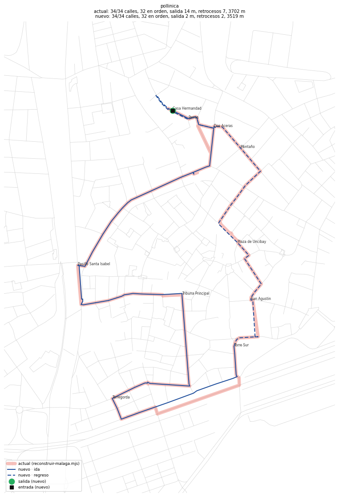 | 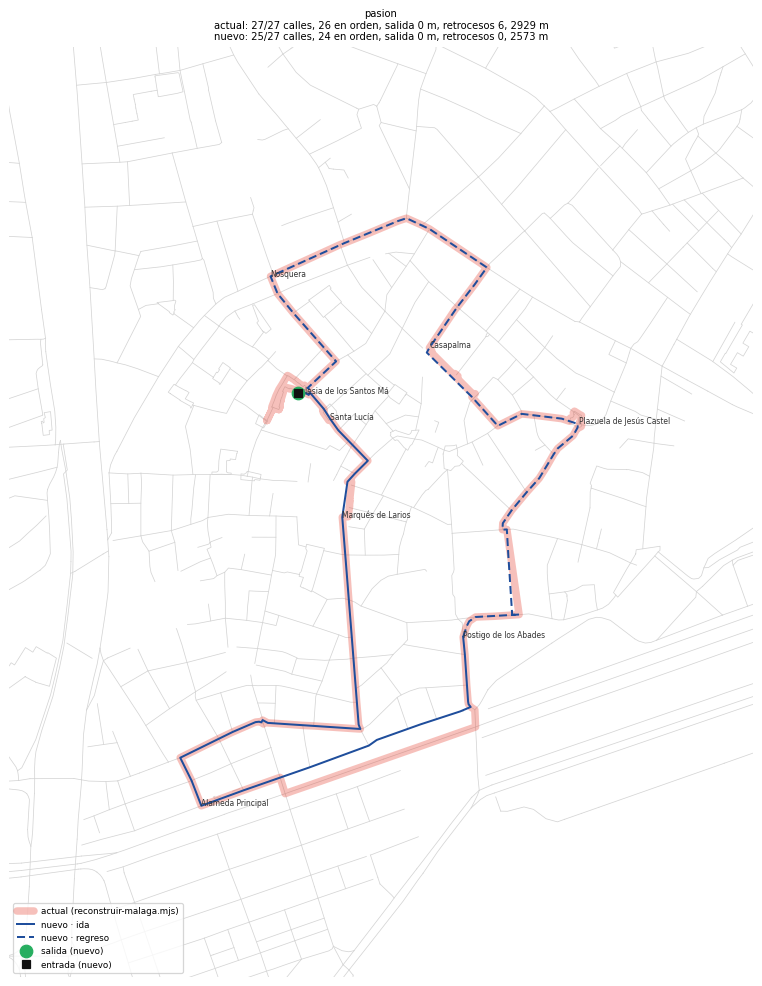 |
| 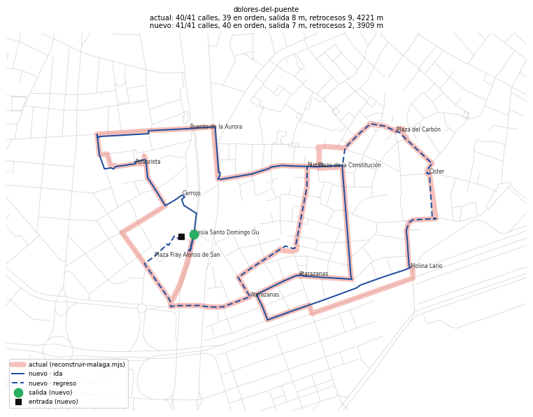 | 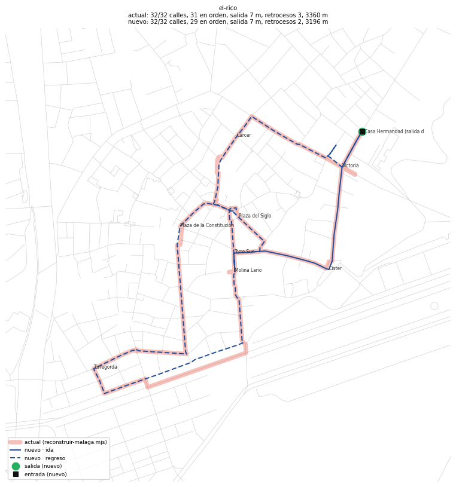 |
| 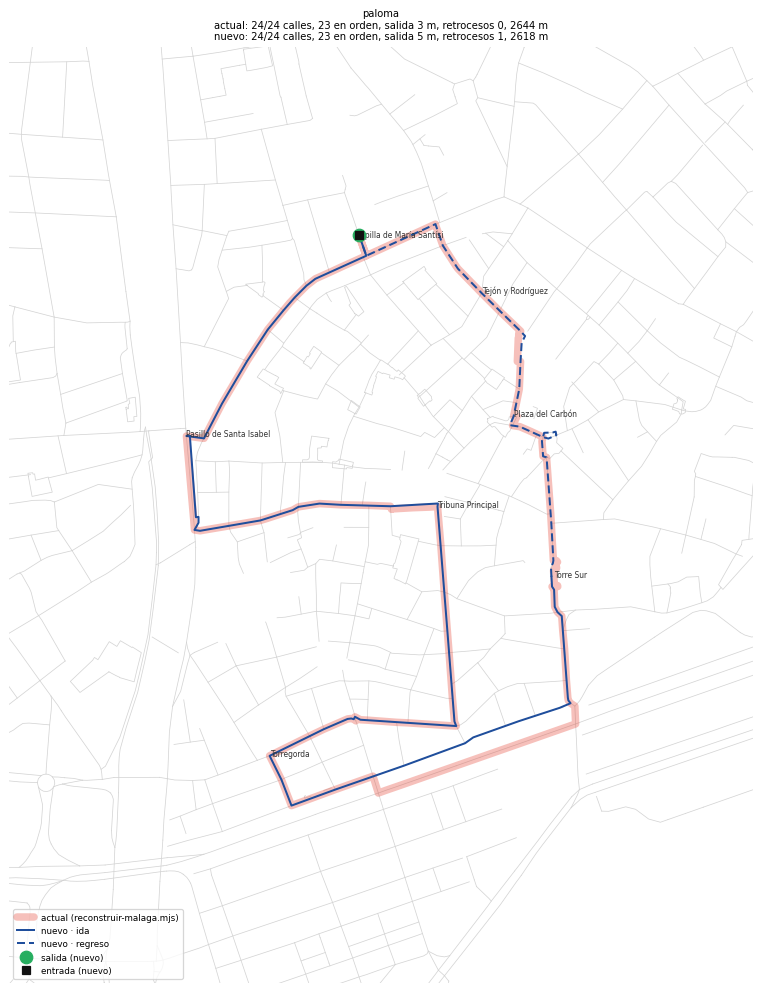 | 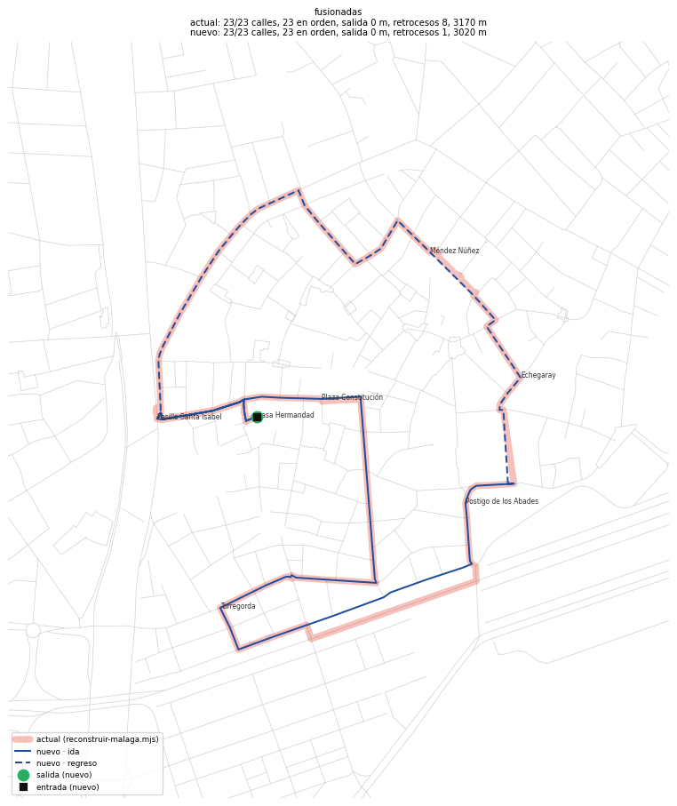 |
| 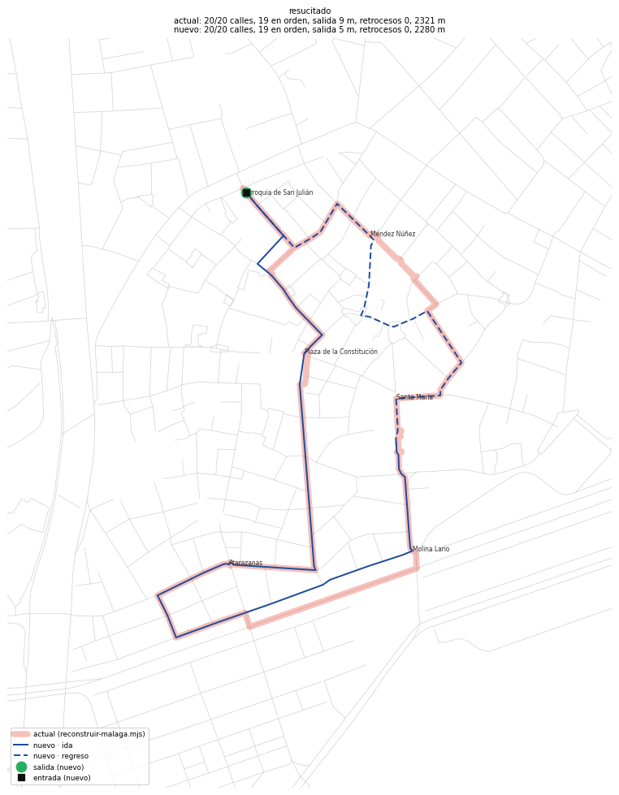 | 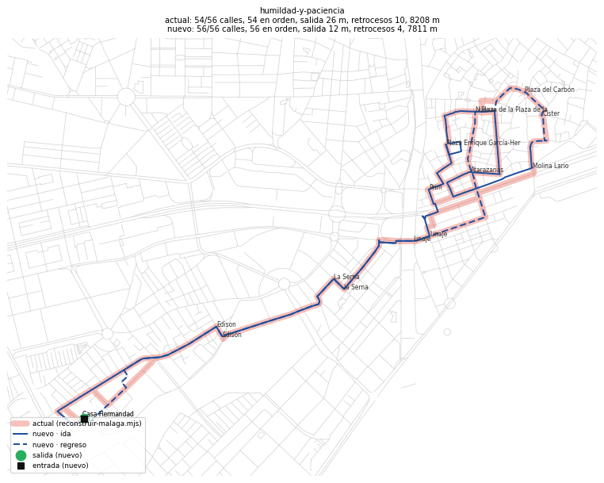 |
| 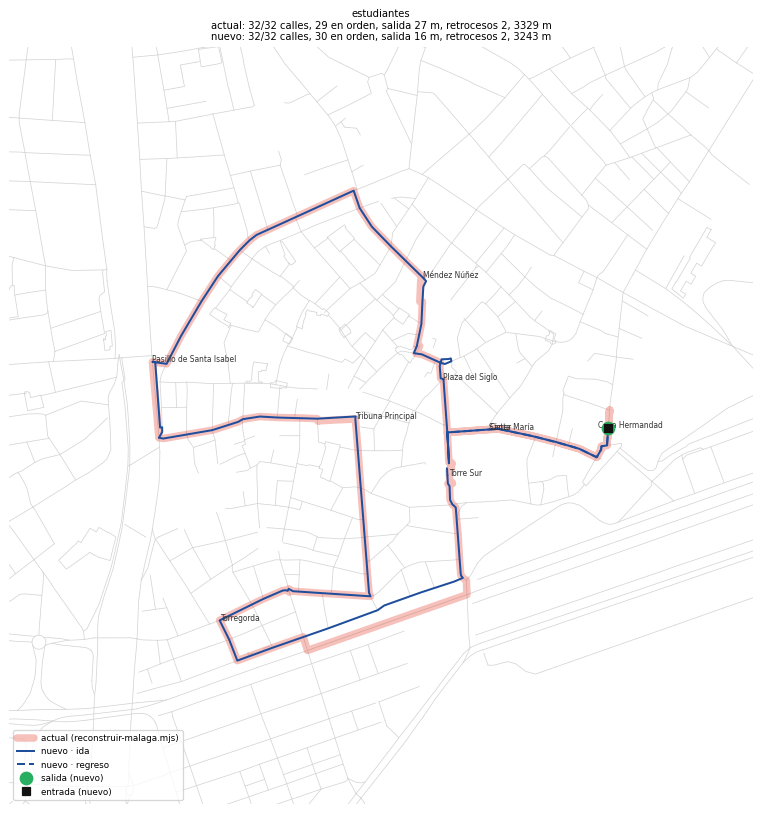 | 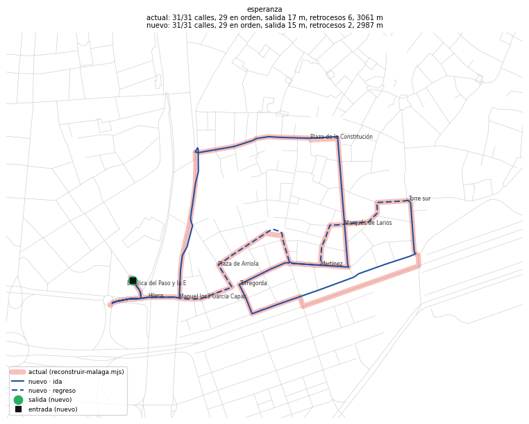 |

## Editor de correcciones (para Pablo)
**Abrirlo:** doble clic en `tools/itinerarios/editor/Abrir editor de rutas.bat`. Enciende el trazador si está apagado (unos 15-30 s) y abre `http://localhost:8765` en el navegador. Solo funciona en tu ordenador y no se publica. Para apagarlo, cierra sus dos ventanas.

**Qué se puede hacer** (la página lo explica en 4 pasos):
- **Elegir la calle buena:** pulsa una calle de la lista oficial; en el plano se ven en naranja las calles con ese nombre (en verde, la elegida). Pulsa «Elegir la calle buena en el plano» y luego la calle. Vale cualquier calle, aunque OSM la llame de otra forma.
- **Arrastrar un punto de paso** (los círculos numerados).
- **Cambiar la salida o la entrada** con los botones de arriba del plano.
- **Calle que OSM no tiene:** «Situar a mano»; o «No trazar esta calle».
- **Fuente obligatoria:** sin escribir de dónde sale la corrección no deja guardar, para no inventar nada. Al guardar, vuelve a trazar al momento.

**Dónde se guarda:** en `tools/itinerarios/laboratorio/correcciones-malaga.json`, con la fecha, la fuente y qué se cambió. El proceso lo respeta cada vez que se regenera. Ahora está vacío: la prueba lo deshizo al acabar.

**Prueba con Playwright** (`python -I tools/itinerarios/laboratorio/probar-editor.py`): **14/14**. Comprueba que se ve el trazador, que están los 33 elementos de la Pasión, que se ven los dos trazados y las candidatas, que se puede elegir la calle en el plano, arrastrar un punto y cambiar la salida, que el contador de cambios funciona, que no deja guardar sin fuente, que el JSON queda bien y que la fila sale como «corregida». También comprueba que la prueba se deshace y que no hay errores en la consola. Capturas en `laboratorio/capturas/editor-inicio.png` y `editor-guardado.png`.

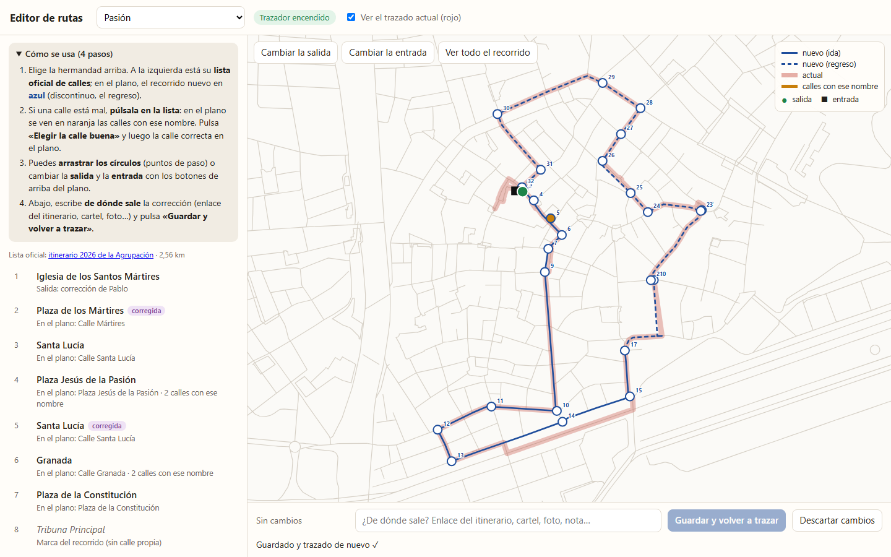

## Recomendación
1. **Para las otras 7 capitales, usar el método nuevo:** continuidad, GraphHopper, evaluador común y editor. Sus reglas son generales (cadena que se toca, puerta de OSM, sin media vuelta, enlace corto anotado) y no dependen de los muchos ajustes que el método actual ha ido acumulando para el casco de Málaga. Rinde igual en cobertura, mejor en retrocesos y encuentra nombres que el actual pierde.
2. **En Málaga, no tocar lo publicado de momento.** Hay empate técnico. Si se quiere, se puede pasar al nuevo después de mirar las 10 capturas y, sobre todo, el arranque de Dolores del Puente y la Plaza de los Mártires de la Pasión.
3. **El editor vale para las dos cosas:** para revisar y corregir a mano cualquier hermandad, y como paso final de revisión en cada capital.
4. **No se adopta nada sin el visto bueno de Pablo.** Nada de esto está en `main` ni en producción.

## Cuánto costaría llevarlo a Sevilla, Córdoba, Granada, Cádiz, Huelva, Jaén y Almería
Son **219 hermandades**: Sevilla 71, Córdoba 42, Cádiz 31, Granada 26, Jaén 18, Almería 16 y Huelva 15. Recuento de `site/data/recorridos/*.json`.

**Lo que ya está hecho y sirve a todas:** GraphHopper con el grafo de Andalucía, el perfil «procesión», el emparejador, el evaluador, las capturas y el editor. También están en caché los callejeros de OSM de las 7 (`cache/osm-<ciudad>.json`).

**Lo que hay que hacer:**
| Trabajo | Para qué | Esfuerzo estimado (Claude) |
|---|---|---|
| 1. Pasar `comun.mjs` y el editor a «una ciudad cualquiera» | Hoy el origen del plano, los archivos, los alias y las puertas de la Catedral son los de Málaga | ½ sesión, una sola vez |
| 2. Adaptador al formato del sitio | Pasar ida/regreso y puntos con hora a `site/data/recorridos/<ciudad>.json`, como hace hoy `reconstruir-malaga.mjs` | ½ sesión, una sola vez |
| 3. Puertas (`entrance`) de cada ciudad | La salida exacta por la puerta. Málaga las tiene por Overpass; para las otras 7 hay que descargarlas igual, o sacarlas del `.pbf` de Geofabrik con una herramienta como osmium, **que habría que instalar: decisión de Pablo** | 7 descargas pequeñas |
| 4. Sedes | Fuera de Málaga no hay `casas-hermandad-<ciudad>.json`. Templos por OSM (`sitios-<ciudad>.json`); las casas hermandad, con fuente, una a una | El trabajo más lento, sobre todo en Sevilla |
| 5. Listas de calles | **Córdoba (40 puntos por hermandad) y Cádiz (28)** tienen listas densas, como Málaga: el método se aplica casi tal cual. **Sevilla (15), Granada (14), Huelva (18), Jaén (17) y Almería (13)** son **rejillas horarias**, con un punto cada media hora y no todas las calles. Ahí las calles seguidas casi nunca se tocan: la continuidad sigue sirviendo para descartar homónimos por cercanía, pero GraphHopper rellena entre puntos con el camino a pie más corto, que **no es dato oficial**. Esos tramos habría que marcarlos como «estimados», o conseguir la lista completa si la fuente oficial la publica | Córdoba y Cádiz: bajo. Las otras 5: medio-alto, y además lectura del PDF (en Sevilla hay texto roto del tipo «P eñ a B é t ic a») |
| 6. Revisión a ojo | Captura de cada hermandad y correcciones en el editor | **Tiempo de Pablo:** unos 2-3 min por hermandad → 7-11 horas para las 219, más las correcciones (calculo que 1 de cada 4 o 5 necesitará alguna) |

**En uso de Claude** (estimación sobre lo que ha costado este laboratorio: unos 8 puntos del uso semanal, con otras sesiones trabajando a la vez, así que es una cota alta):
- Piezas comunes (filas 1 y 2): **≈ 4-6 %** del uso semanal, una sola vez.
- Córdoba y Cádiz: **≈ 3-5 % cada una**.
- Granada, Huelva, Jaén y Almería: **≈ 4-6 % cada una**, por la limpieza de las rejillas y los tramos estimados.
- Sevilla: **≈ 8-12 %** (71 hermandades, rejilla con texto roto, muchas sedes).
- **Total ≈ 35-50 % de una semana de uso**. Con el tope del 88 %, caben en 1-2 semanas, por tandas de 2 o 3 capitales.

**En tiempo de ordenador:** despreciable. Unos 2 s por hermandad, unos 8 min en total, más 14 s para arrancar GraphHopper. No hay que volver a importar nada: el grafo de Andalucía ya lo cubre todo. Solo conviene renovar el `.pbf` de Geofabrik, unos 90 s de importación, cuando se quiera OSM más reciente.

**Orden recomendado:** primero Córdoba y Cádiz (listas densas, resultado rápido y comparable con Málaga), luego Granada, Jaén, Huelva y Almería, y Sevilla al final.

## Límites y riesgos (honestos)
- El evaluador lo he escrito yo para este laboratorio. Mide lo mismo en los dos trazados, pero **no sustituye la comparación a ojo con el PDF oficial**.
- El método nuevo depende de un servidor Java local mientras se generan las rutas. El sitio publicado no cambia: sigue siendo JSON estático dibujado en SVG propio, sin Leaflet ni teselas.
- Cuando OSM no une dos calles, cualquiera de los dos métodos necesita un enlace o una corrección. La solución de raíz sería corregir OSM, cosa que **no he hecho**.
- La línea base es la versión `origin/main` de hoy. Si la sesión de Málaga sigue cambiando `reconstruir-malaga.mjs`, habría que repetirla: `cd tools/itinerarios/laboratorio/actual` → copiar los archivos de nuevo → `node reconstruir-malaga.mjs <id>`.

## Cómo repetirlo
```
cd C:\Users\pablo\Herramientas-IA\graphhopper ; java -Xmx3g -jar graphhopper-web-11.1.jar server config.yml   # deja la ventana abierta
cd tools\itinerarios\laboratorio
node emparejar.mjs                 # las 10 con el método nuevo → salida/nuevo/
node evaluar.mjs                   # comparación → salida/comparacion.json
python -I capturar.py              # capturas → capturas/
python -I probar-editor.py         # prueba del editor (con node ..\editor\servidor.mjs encendido)
```

## Historial
- 2026-10-25: descargas (GraphHopper 11.1 y Andalucía, MD5 comprobado), perfil «procesión», primera línea base. Pausa por el límite de 5 horas.
- 2026-10-26: rebase sobre `origin/main` (bdf9903) y nueva línea base; emparejamiento por continuidad + GraphHopper en las 10; evaluador común, capturas y comparación; editor de correcciones probado con Playwright (14/14); coste para las 7 capitales. GraphHopper y el editor, apagados.
